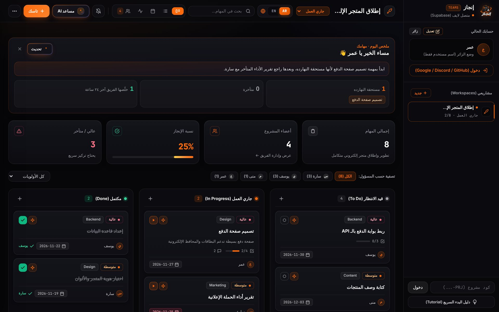
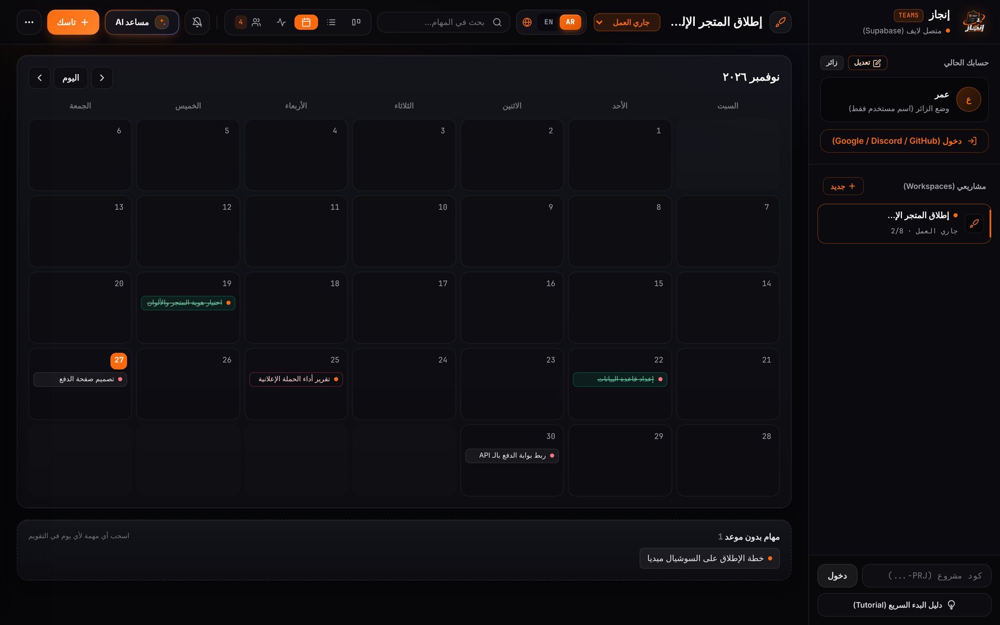
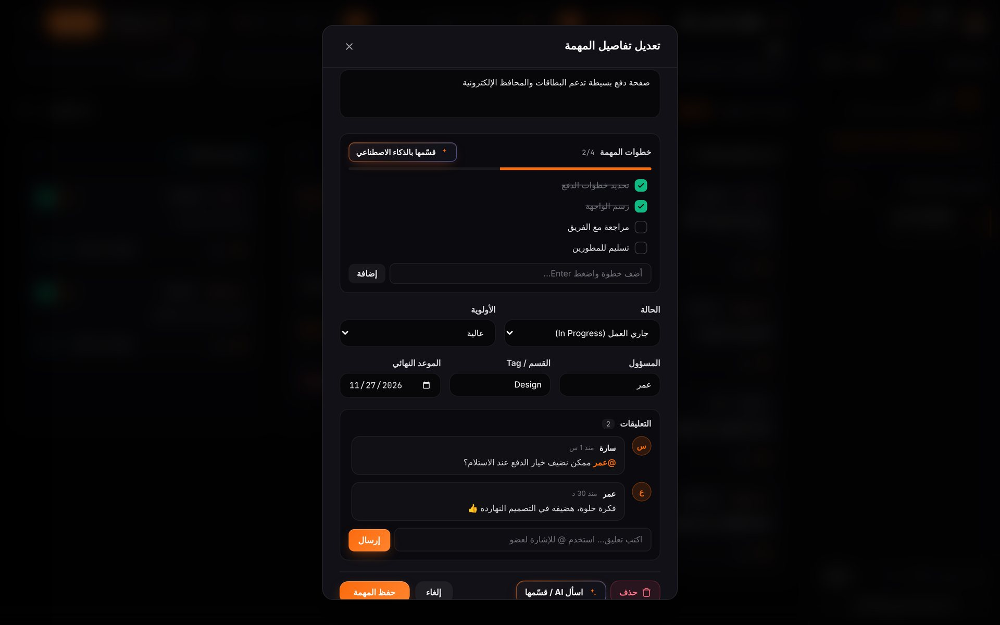
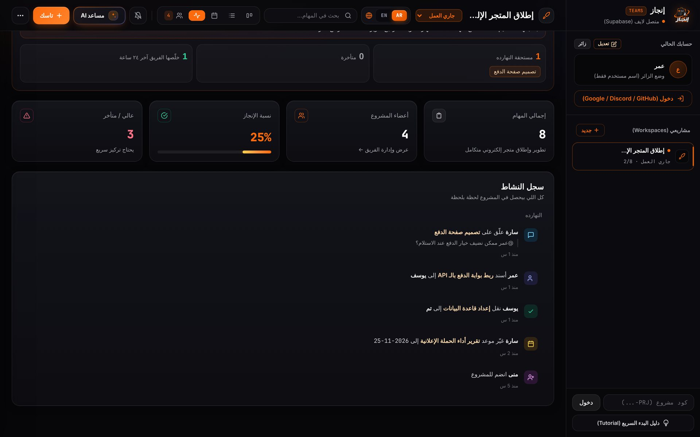
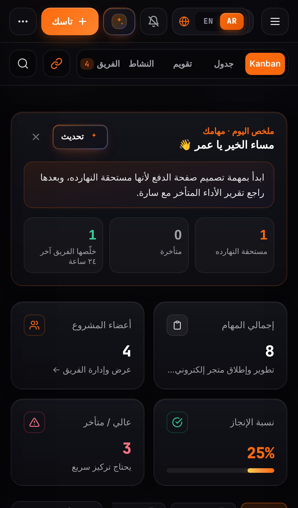

<div align="center">


# Enjaz · إنجاز

**Real-time team project management with an AI assistant — Arabic-first, fully bilingual.**

[](LICENSE)


</div>

---

## نبذة

**إنجاز** تطبيق ويب لإدارة مشاريع الفرق، بالعربي والإنجليزي، وتحديثاته لحظية. فيه:

- لوحة كانبان، وجدول، وتقويم
- تعليقات على المهام بالإشارة @
- سجل نشاط وإشعارات
- ملخص يومي
- مساعد ذكاء اصطناعي بيقسّم المهام لخطوات

كل مشروع محمي جوه قاعدة البيانات نفسها، ومحدش يشوفه غير أعضاؤه. وتقدر تثبّت التطبيق على الموبايل وتتصفحه من غير إنترنت.

---

## Contents

- [Features](#features)
- [Screenshots](#screenshots)
- [Tech stack](#tech-stack)
- [Getting started](#getting-started)
- [Project structure](#project-structure)
- [How it works](#how-it-works)
- [Development guide](#development-guide)
- [Troubleshooting](#troubleshooting)
- [License](#license)

## Features

**Plan and track**
- **Five views:** Kanban (drag & drop), table, calendar (drag tasks between days), activity feed, and team.
- **Tasks** with priority, assignee, tag, due date, notes, and overdue highlighting.
- **Checklists** inside each task, with progress shown on the card.
- **Search and filters** by member and priority.

**Collaborate**
- **Live sync** through Supabase Realtime: every change appears for the whole team instantly.
- **Comments with `@mentions`** and autocomplete.
- **Activity feed:** every task change, comment and new member. Database triggers write it, so it can't be faked.
- **Notifications:** in-app, plus browser notifications when the tab is in the background, for tasks assigned to you, mentions, and comments on your tasks.
- **Join by code or share link.** Codes like `PRJ-7KQ2-MX9D-4HTA` are random and can't be guessed.

**AI (via [Puter.js](https://puter.com), no API key needed)**
- **Chat assistant** that knows the project or task you're looking at, with 10+ models and automatic fallback.
- **Turns goals into task cards** you add with one click; can also read images you attach.
- **"Break it down"** writes a checklist for a task.
- **Daily summary** card, with an optional AI-written brief on what to focus on.

**Experience**
- **Arabic (RTL) and English (LTR)**, switched instantly.
- **Instant updates:** changes show at once and roll back if saving fails.
- **Undo** deleted tasks for 5 seconds.
- **Installable PWA** that you can still browse offline.
- **OAuth sign-in** (Google, Discord, GitHub), or continue as a guest. A guest keeps their projects after signing in.
- **Custom project icons or logos**, plus an onboarding tutorial.

## Screenshots

| Kanban board & daily summary | Calendar |
|---|---|
|  |  |
| **Task with checklist & comments** | **Activity feed** |
|  |  |

<p align="center"></p>

## Tech stack

| Layer | Technology |
|---|---|
| UI | Plain HTML, CSS and JavaScript (no framework, no build step) |
| Styling | [Tailwind CSS](https://tailwindcss.com) (Play CDN), custom CSS |
| Backend | [Supabase](https://supabase.com): Postgres, Auth, Realtime, row-level security |
| AI | [Puter.js](https://docs.puter.com) (free, runs in the browser) |
| Offline | Service worker and web app manifest |
| Fonts | IBM Plex Sans Arabic, Cairo, Inter, JetBrains Mono |

## Getting started

### 1. Create the Supabase project

1. Create a project at [supabase.com](https://supabase.com).
2. In **Authentication → Sign In / Providers**, turn on:
   - **Allow anonymous sign-ins**: guests get an anonymous session so the database knows who they are.
   - **Allow manual linking**: a guest who later signs in with OAuth keeps their projects.
   - Any OAuth providers you want (Google, Discord, GitHub), and add your site URL to the redirect URLs.
3. Open the **SQL Editor** and run all of [`supabase/schema.sql`](supabase/schema.sql).
   - It is idempotent, so run it again whenever the file changes.
4. Optional: run [`supabase/diagnose.sql`](supabase/diagnose.sql). It's read-only, and every row should say **OK**.

### 2. Point the app at your project

Edit [`js/state.js`](js/state.js):

```js
const SUPABASE_URL = 'https://<your-project>.supabase.co';
const SUPABASE_KEY = '<your publishable (anon) key>';
```

The publishable key is meant to be public. Row-level security is what protects the data.

### 3. Run it

No install or build is needed. Serve the folder with any static server:

```bash
python3 -m http.server 8080
```

Then open `http://localhost:8080` for the landing page, or `http://localhost:8080/enjaz.html` for the app.

> OAuth doesn't work from `file://`, so use a local server or a real host.

### 4. Deploy

Any static host works: GitHub Pages, Netlify, Vercel, Cloudflare Pages. With **GitHub Pages**:
1. Go to **Settings → Pages**, deploy from the `main` branch root.
2. Add the Pages URL to Supabase's redirect URLs.

## Project structure

```
├── index.html               Landing page / portfolio
├── enjaz.html               The app
├── manifest.webmanifest     PWA manifest
├── sw.js                    Service worker (offline cache, notification clicks)
├── css/
│   ├── base.css             App base styles
│   ├── animations.css       App animations
│   ├── components.css       App components (AI drawer, calendar, …)
│   └── home.css             Landing page styles
├── js/                      App scripts, loaded in this order by enjaz.html:
│   ├── state.js             1. Supabase client and shared state
│   ├── i18n.js              2. Arabic/English strings, language switching
│   ├── ui.js                3. Modals, toasts, icons, tutorial, helpers
│   ├── auth.js              4. Sessions, guests, profile, membership
│   ├── data.js              5. Loading data, realtime
│   ├── render.js            6. Sidebar, Kanban, table, team views
│   ├── projects-tasks.js    7. Project and task create/edit/delete
│   ├── ai-assistant.js      8. AI chat and task divider
│   ├── features.js          9. Comments, checklist, calendar, activity,
│   │                           notifications, summary, undo, offline
│   ├── app.js              10. Startup and keyboard shortcuts
│   ├── home.js              Landing page logic
│   └── tailwind-config.js   Shared Tailwind theme
├── supabase/
│   ├── schema.sql           Tables, row-level security, functions, triggers
│   └── diagnose.sql         Read-only setup check
├── assets/                  Logos and PWA icons
└── docs/screenshots/        Images used in this README
```

The scripts are classic `<script>` tags that share globals, so **order matters**: a file may only use, at load time, what earlier files defined. Functions called later, at runtime, can live anywhere. Every function is documented with a JSDoc comment.

## How it works

### Data model

| Table | Purpose |
|---|---|
| `projects` | Name, description, icon, status, `owner_id` |
| `tasks` | Title, notes, status, priority, assignee, tag, due date, `subtasks` (JSON checklist) |
| `project_members` | Who belongs to which project, with name, role and avatar |
| `task_comments` | Comments with `mentions` |
| `activity_log` | Append-only feed, written by triggers |

### Security

All access rules live in the database ([`supabase/schema.sql`](supabase/schema.sql)), never only in the browser:

- **Row-level security:** users can only read and change projects they're members of, plus those projects' tasks, comments and activity.
- **Joining** happens only through the `join_project(code)` function. The code is the invitation.
- **Deleting a project** is allowed for the owner only. Everything inside it is removed with `ON DELETE CASCADE`.
- **Own data only:** members can edit only their own member row and their own comments.
- **Activity rows** can't be inserted by clients; triggers write them.
- **Guests** use Supabase anonymous auth, so even they have a real identity for these rules.

### Realtime and instant updates

- **Realtime:** the app subscribes to Supabase Realtime for all five tables, and row-level security filters events to the user's projects.
- **Instant updates:** local changes are applied before the server confirms them and rolled back on error (`trackPendingWrite` in `features.js`). A background refresh can't overwrite a change that is still being saved.

### Offline and PWA

- **App files:** `sw.js` caches them (network-first) and the CDN libraries (stale-while-revalidate).
- **Data:** the last loaded data is kept in `localStorage`, so the app opens offline, read-only.

## Development guide

- **No tooling required:** edit the files and refresh the page.
- **Escape all user content** inserted into HTML with `escapeHtml()`. For values inside inline handlers like `onclick="fn(…)"`, use `jsArg()`.
- **Translations:**
  - App strings live in `js/i18n.js`; newer ones are added with `Object.assign(I18N.ar, …)` in `js/features.js`.
  - Landing page strings live in `js/home.js`.
  - Elements with `data-i18n="key"` are translated automatically.
  - Always add both `ar` and `en`.
- **Database changes:** append them to `supabase/schema.sql` in an idempotent way (`if not exists`, `drop policy if exists`, `create or replace`), and grant API access to new tables explicitly.
- **Service worker:** when you add files to the app shell, add them to `APP_SHELL` in `sw.js` and bump `CACHE_VERSION`.

## Troubleshooting

| Problem | Fix |
|---|---|
| "Could not send comment" / data won't save | Run `supabase/schema.sql` again, then `supabase/diagnose.sql` to see what's missing. The error toast also shows the reason. |
| Guests from before the security update lost their projects | Their old identity lived only in the browser. They need to re-join with the project code. |
| OAuth sign-in does nothing | Serve over `http(s)`, not `file://`. Check the provider is enabled and your URL is in Supabase's redirect URLs. |
| AI replies fail | Allow the Puter sign-in popup, or pick another model in the AI drawer. |
| No browser notifications | Click the bell to allow them. They're delivered while the app is open in some tab. |

## License

Copyright (C) 2026 **Omariooo**

Enjaz is free software: you can redistribute it and/or modify it under the terms of the **GNU General Public License** as published by the Free Software Foundation, either **version 3** of the License, or (at your option) any later version. It is distributed in the hope that it will be useful, but **without any warranty**. See the [LICENSE](LICENSE) file for the full text.

In short:
- You may use, study, share and modify Enjaz.
- If you distribute it or anything built from it, you must release that under the GPL too, with its source code, and keep this copyright notice.

Third-party libraries loaded from CDNs (Tailwind CSS, supabase-js, Puter.js) and the fonts keep their own licenses.
